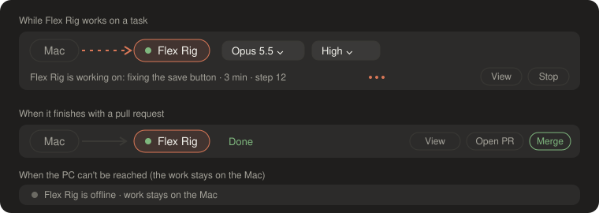

# Flex Rig

A tool that hands a Claude Code chat's coding work off to a second, always-on computer.

You chat in the Claude Code desktop app on your Mac. For each chat you choose where its coding work runs: on the Mac, or on another machine that stays on (today, a Windows PC with its own Claude login). That machine does the work in its own git worktree, opens a pull request, and you watch, steer and merge from the same chat. The Mac can sleep, its usage stays low, and nothing the other machine does touches your working folder.

> **About the name.** "Flex Rig" is just the quirky name the author gave their always-on PC, and the tool's name came from that. Everywhere this README, the bar and the skill say "Flex Rig", read it as "my other computer". Nothing depends on the name. See [Using your own name](#using-your-own-name) to relabel it with whatever you call your machine.



*An illustration of the bar. Replace it with a real screenshot if you like.*

## What's in the box

| Part | What it does |
|---|---|
| **Code work bar** (`code-work/`) | A Claude Code desktop mod: a band above the prompt. For each chat, pick **Mac** (do the work here) or the remote machine (labelled "Flex Rig" by default; yours can be called anything). Also pick the remote machine's model and effort, see an online light and a live "working on…" line, and use **Stop**, **View**, **Open PR** and **Merge**. A side panel shows the remote task's conversation and lets you message it. A new chat's first message waits until you pick a machine. While the Mac only waits, its check-ins run on Haiku to save usage. |
| **flex-rig skill** (`skill/`) | `flexrig.sh` and a `SKILL.md` that teach Claude to send a task to the remote machine over SSH. It first pushes your local edits to a branch (never `main`), waits in 2.5-minute foreground calls so the chat shows "working", relays your messages to the running task, fetches what it made (screenshots, HTML pages, CSV, PDF), and merges. |
| **Runner** (`runner/`) | `flexrig.mjs` runs on the remote PC. It runs each task in its own git worktree with the PC's own Claude login, gives it a hidden test browser and a way to start the app it built, and opens a PR. |
| **Routing rule** (`mac/flex-rig-rule.md`) | A short rule installed in `~/.claude/rules/` that makes Claude follow the bar. |
| **Repo sync** (`mac/repo-sync.sh`) | A LaunchAgent that keeps `main` up to date in every repo in your repos folder. It never stashes, resets, commits or deletes. |

## Requirements

- **Mac:** the Claude Code desktop app with mod support, plus `git`, `gh` (signed in), `jq`, `node`, `rsync` and `ssh`. Homebrew installs them all.
- **PC:** Windows 10/11 with OpenSSH Server, Git, GitHub CLI (`gh`, signed in), Node.js (a current LTS), and Claude Code signed in to the account you want the PC to use. Its repos must be cloned already.
- **Network:** the Mac must reach the PC over SSH with key login (no password prompt). Same home network, a VPN, or something like Tailscale all work.
- **Repos:** every repo you want to use lives on GitHub, is cloned in a repos folder on both machines, and has the same folder name on both.

## Set up

### 1. On the PC

1. Turn on OpenSSH Server (Settings → System → Optional features → OpenSSH Server, then start the `sshd` service and set it to Automatic).
2. Make PowerShell the SSH shell. The installer and the scripts send PowerShell commands:
   ```powershell
   New-ItemProperty -Path "HKLM:\SOFTWARE\OpenSSH" -Name DefaultShell -Value "C:\Windows\System32\WindowsPowerShell\v1.0\powershell.exe" -PropertyType String -Force
   ```
3. Add your Mac's public key (`~/.ssh/id_ed25519.pub`) to the PC. For a normal user that is `C:\Users\<you>\.ssh\authorized_keys`. For an administrator it is `C:\ProgramData\ssh\administrators_authorized_keys`.
4. Install Git, GitHub CLI, Node.js and Claude Code, then run `gh auth login` and `claude` once so both are signed in.
5. Clone your repos into one folder, for example `C:\Users\<you>\Code`.

### 2. On the Mac

```bash
git clone <this repo> flex-rig && cd flex-rig
bash install.sh        # first run creates ~/.flexrig/config and stops
```

Open `~/.flexrig/config` and fill in your PC's address and your repo folders (every setting is explained in [`flexrig.config.example`](flexrig.config.example)). Check that this works with no password prompt:

```bash
ssh your-windows-user@your-pc-address hostname
```

Then run the installer again:

```bash
bash install.sh
```

It installs the bar, the rule and the skill on the Mac, copies the runner to the PC and registers it as a scheduled task there, installs the PC's test browser (the first run downloads Chromium, which takes a few minutes), and starts the repo-sync LaunchAgent. Open a **new** Claude Code chat and the bar appears above the prompt. Run `install.sh` again any time to update.

## Use it

- **Pick a machine** with the buttons in the bar, or type `/code-work mac` or `/code-work flex`. The pick is per chat.
- **Just ask Claude for coding work.** With the bar on Flex Rig, Claude writes a brief, pushes your local edits, and starts the task on the PC. The line under the buttons shows what it is doing.
- **Steer it:** type a message in the chat (it reaches the PC within about 2.5 minutes), or use **View** to open the side panel and message it right away.
- **When it finishes:** use **Open PR** to look, **Merge** to ask Claude to merge it and update your Mac's folder.
- **Offline PC:** the bar's light goes grey and Claude does the work on the Mac instead.

Anything you see in Claude's chat you can also run yourself. `flexrig.sh` with no arguments prints every command (`start`, `say`, `wait`, `followup`, `merge`, `status`, `stop`, `preview`, `takeover`, `ask`, …).

If a task's test browser hits a sign-in page it stops and says so. Open the PC over Remote Desktop, double-click **Flex Rig browser sign-in** on its desktop, sign in once, and close the window.

## Using your own name

The labels "Flex Rig" and "Mac" are only text. To call your remote machine something else (say "Desk PC" or "Build Box"), replace the two-word phrase everywhere, then reinstall:

```bash
cd flex-rig
grep -rl "Flex Rig" --exclude-dir=.git --exclude=README.md . | xargs sed -i '' 's/Flex Rig/Desk PC/g'     # on Linux, drop the '' after -i
bash install.sh
```

That changes what the bar, the skill and the notes to Claude say, and the tests still pass because they get the same replacement. Leave the one-word names `flexrig`, `flex-rig` and `~/.flexrig` alone: those are file, folder and command names, not labels. (If you want the slash command to match, it is `/code-work mac` and `/code-work flex`; the word after it only needs to start with `flex`, `rig`, `pc` or `windows`.)

## Settings

All settings live in `~/.flexrig/config`:

| Setting | Meaning |
|---|---|
| `FLEXRIG_HOST` | `user@address` of the PC (required) |
| `FLEXRIG_LOCAL_REPOS` / `FLEXRIG_REMOTE_REPOS` | the folder holding your repos on the Mac / on the PC |
| `FLEXRIG_DEFAULT_REPO` | the repo a task goes to when you don't name one |
| `FLEXRIG_AREA_REPOS` | repos (colon-separated) that hold many apps, where `--area <folder>` is required |
| `FLEXRIG_REMOTE_HOME` | only if the PC user's home isn't `C:\Users\<user>` |

Models and effort come from the bar, not from this file. The model menu lists the newest Fable, Opus, Sonnet and Haiku your Claude Code knows about.

## Safety

- Your working folder is never touched. Local edits go to a throwaway branch through a temporary git index.
- Files that look like secrets (`.env`, keys, `*.pem`, credentials) and files over 20 MB are left out of the push, and a key found inside an edit stops everything before anything is pushed.
- The PC's Claude only edits files, runs `git`, `gh`, `npm`, `npx` and `node`, and uses its own hidden browser. It never merges or deploys. Merging happens from the Mac.
- Pages the test browser opens are treated as data, never as instructions.

## Limits

- The runner is Windows-only today (it uses Windows scheduled tasks, PowerShell and `taskkill`). A Linux or macOS runner would need new install and process code.
- The Mac side is macOS-only (LaunchAgent, `/usr/bin/nc`).
- The PC must be reachable over SSH. Away from that network the bar shows offline and the work stays on the Mac.
- It depends on the Claude Code desktop app's mod interface and on how the app draws a mod's band (see [`docs/desktop-rendering.md`](docs/desktop-rendering.md)). Either can change.
- Repos must be on GitHub (pull requests use `gh`) and cloned on both machines.
- The PC needs its own Claude login. You are responsible for that account's terms and usage limits.

## Tests

```bash
claude plugin test code-work        # the bar
node --test runner/                 # the runner (a few tests need Windows and are skipped elsewhere)
```

## License

MIT. See [LICENSE](LICENSE).
